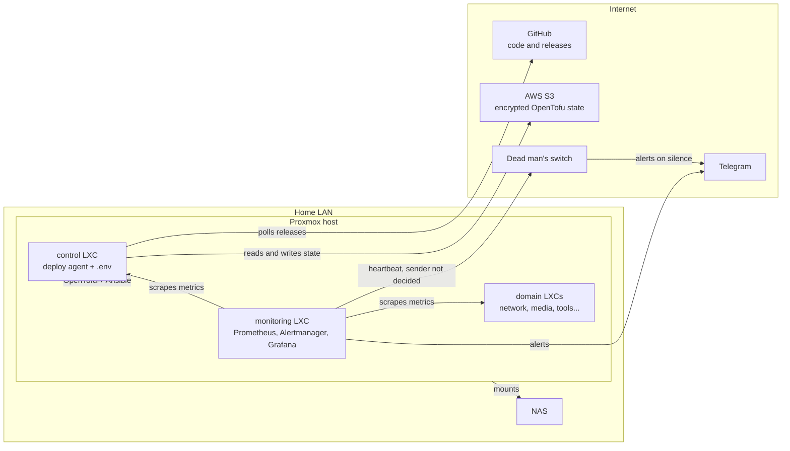
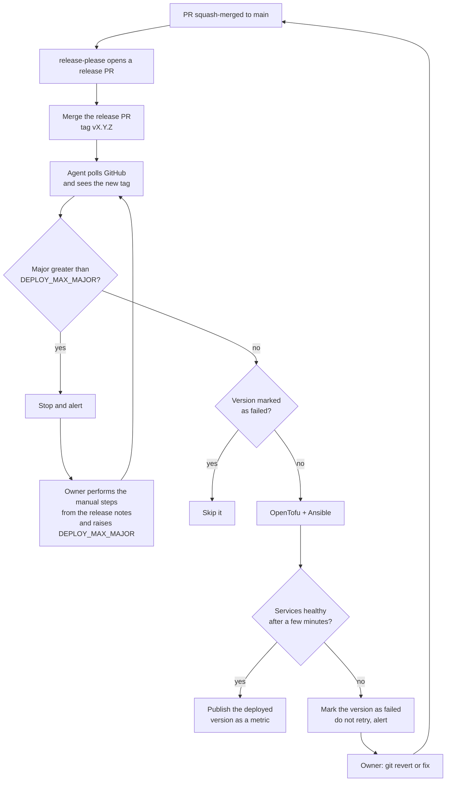
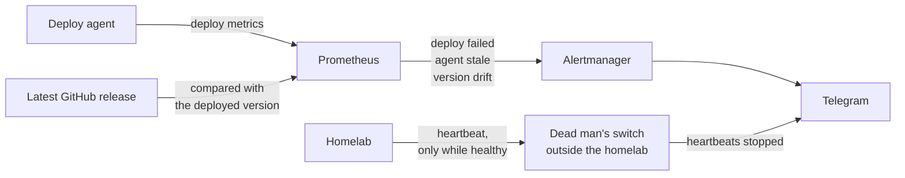
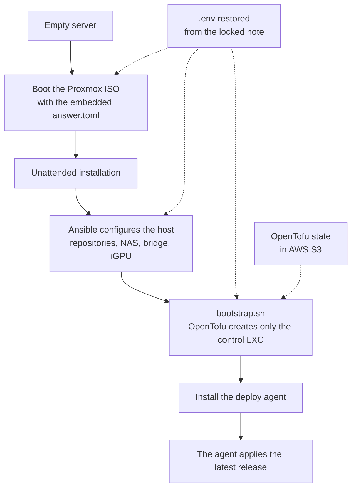
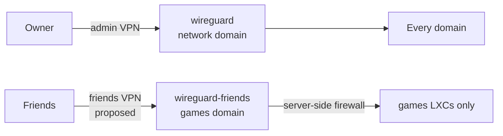

# Architecture

One Proxmox server runs a small number of LXC containers. OpenTofu creates them, Ansible configures them, and Docker Compose runs the services inside them. An agent inside the LAN applies every release automatically.

## Overview

Every arrow between the house and the internet starts inside the house. Nothing on the internet opens a connection to the homelab ([ADR-0004](decisions/0004-pull-based-deployment.md)).

## Layers

| Layer | Tool | Responsibility |
|-------|------|----------------|
| Hypervisor | Proxmox | Runs the LXC containers and VMs, installed unattended ([ADR-0015](decisions/0015-automated-proxmox-host.md)) |
| Provisioning | OpenTofu | Creates LXC containers and VMs ([ADR-0007](decisions/0007-encrypted-remote-state.md)) |
| Configuration | Ansible | Configures the host, installs the platform, and deploys each domain |
| Runtime | Docker Compose | Runs the services, with CPU and memory limits per container |

Kubernetes is intentionally absent ([ADR-0001](decisions/0001-single-deployment-path.md)).

## Life of a change

| Step | Decision |
|------|----------|
| Deployment model | Pull ([ADR-0004](decisions/0004-pull-based-deployment.md)), by a Python agent on a systemd timer ([ADR-0020](decisions/0020-deploy-agent-in-python.md)) |
| Versioning and the major gate | [ADR-0008](decisions/0008-release-versioning.md), [ADR-0013](decisions/0013-first-version-and-pre-1-0-behaviour.md) |
| Undoing a change | Roll forward ([ADR-0009](decisions/0009-roll-forward.md)) |
| Proposing updates | Renovate ([ADR-0014](decisions/0014-dependency-updates-with-renovate.md)) |

## Knowing that it works

The agent cannot be its own watcher, and nothing inside the house can report a power cut ([ADR-0005](decisions/0005-deploy-observability.md)).

| Failure | Detected by |
|---------|-------------|
| A deploy fails | The agent's metrics, scraped by Prometheus |
| The agent stops running | Prometheus: the agent's metric goes stale |
| The deployed version differs from the latest release | Prometheus: drift alert |
| The whole homelab is down (power, internet, Proxmox) | External dead man's switch: heartbeats stop arriving |

## Rebuilding from nothing

What describes the infrastructure never lives inside it.

| Asset | Lives in | Recovery |
|-------|----------|----------|
| Code and configuration | GitHub | `git clone` |
| Secrets (`.env`) | Control LXC, NAS copy, encrypted offsite copy | [ADR-0006](decisions/0006-secrets-management.md) |
| OpenTofu state | AWS S3, versioned and encrypted client-side | [ADR-0007](decisions/0007-encrypted-remote-state.md), [ADR-0018](decisions/0018-state-bucket-on-aws-s3.md) |

Details: [ADR-0011](decisions/0011-greenfield-bootstrap.md), [ADR-0015](decisions/0015-automated-proxmox-host.md).

## Host maintenance

Host updates reboot only in a fixed window, Saturday at 04:00, when needed and with no deploy running ([ADR-0016](decisions/0016-host-reboot-maintenance-window.md)). Host network changes are breaking changes and are applied by hand with console access.

## Access

Everything is reached through VPN. Nothing is published to the internet today ([ADR-0010](decisions/0010-vpn-only-access.md)).

