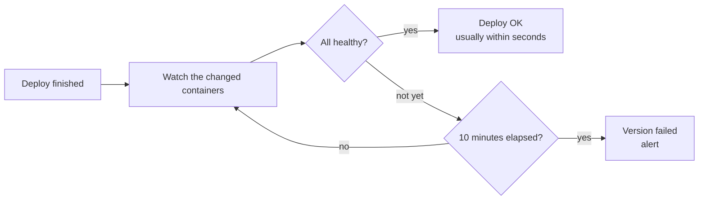

# ADR-0021: Agent polling interval and health check

- **Status:** Accepted
- **Date:** 2026-11-27

## Decision

| Parameter | Value |
|-----------|-------|
| Polling interval | The agent checks GitHub for a new release **every 5 minutes** |
| Health check scope | Only the containers the deploy changed |
| Healthy | Running, not in a restart loop, and `healthy` if the image defines a `HEALTHCHECK` |
| Health check timeout | **10 minutes**, as a maximum, not a fixed wait |

## Context

[ADR-0020](0020-deploy-agent-in-python.md) left both parameters open. The health check comes from [ADR-0009](0009-roll-forward.md).

## Reasoning

| Parameter | Why |
|-----------|-----|
| 5-minute polling | 12 requests per hour, far below the 60 per hour GitHub allows unauthenticated. Waiting up to 5 minutes for a deploy to start does not matter in a homelab |
| 10-minute timeout | Services that migrate their database on a version change (n8n, Postgres, Jellyfin) can take minutes to become healthy. A short window would mark slow but correct versions as failed |
| Timeout, not fixed wait | A healthy deploy completes as soon as its containers are healthy. The full 10 minutes are only spent when something is slow or broken |

## Consequences

- A broken release is reported at most 10 minutes after its deploy.
- A container that fails after the deploy was declared OK is not the agent's concern: monitoring alerts on it like any other failure.
