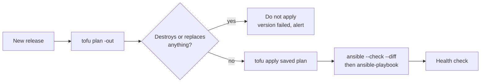

# ADR-0024: The agent refuses plans that destroy or replace resources

- **Status:** Accepted
- **Date:** 2026-11-27

## Decision

Changes are verified **before they are applied**, not before they are merged:

1. CI runs the static checks of [ADR-0023](0023-ci-checks.md) on every pull request.
2. The deploy agent always runs `tofu plan -out` before `tofu apply`, and applies only that saved plan.
3. **If the plan destroys or replaces any resource, the agent does not apply it.** It stops, alerts, and marks the version as failed ([ADR-0009](0009-roll-forward.md)).
4. Before running a playbook for real, the agent runs it with `--check --diff` and logs the result.
5. Otherwise it applies, then runs the health check of [ADR-0021](0021-agent-polling-and-health-check.md).

## Context

There is no staging environment: every merge reaches the only server ([ADR-0004](0004-pull-based-deployment.md)). With the pull model, GitHub Actions cannot reach the Proxmox API to run `tofu plan`, so the first one to see what a change does is the agent. The dangerous case is a change that destroys or replaces an LXC and the data inside it.

## Consequences

- No change can destroy infrastructure without the owner stepping in. A destroy or replace that loses data is already a breaking change the agent holds back ([ADR-0008](0008-release-versioning.md)); the guard catches the ones whose commit was not marked as breaking.
- The plan is not visible before the merge. A wrong but non-destructive change is still applied, and caught by the health check or monitoring.
- An intended destroy or replace needs a manual apply by the owner, followed by a release the agent can apply cleanly.
- Ansible `--check` is informational: modules that depend on earlier tasks can report false differences, so it does not block.

## Alternatives rejected

| Alternative | Why not |
|-------------|---------|
| Agent plans open pull request branches and posts a commit status | The real check before merge, but the agent needs a GitHub token with write access, and it runs unmerged code inside the LAN with its credentials. `tofu plan` can execute code (providers, `external` data sources). Kept as a possible improvement after release 1 |
| Staging environment | A second server or a nested Proxmox, too much cost for a homelab |
| Trust the static checks alone | Nothing stops a change that wipes an LXC with data |
