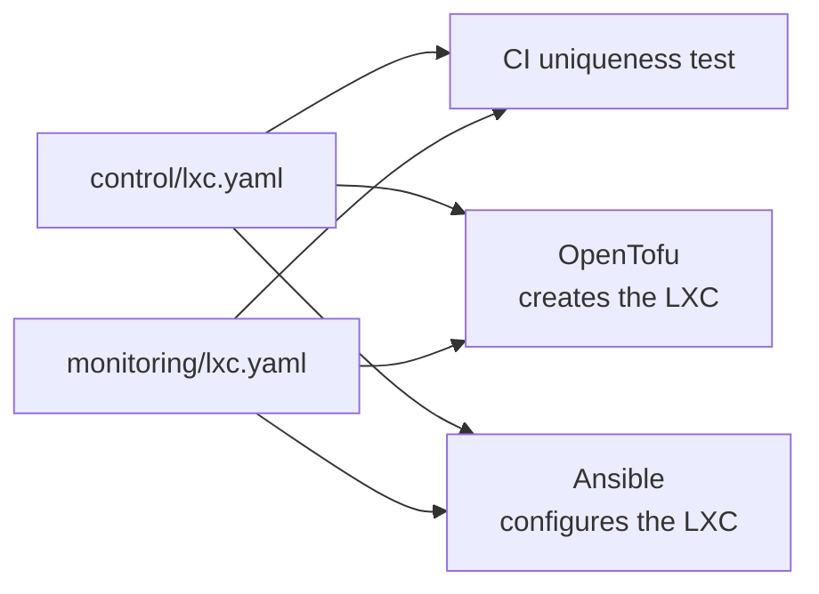

# ADR-0025: LXC definitions live in one inventory file per domain

- **Status:** Accepted
- **Date:** 2026-11-27

## Decision

Each domain declares its LXC containers in **`<domain>/lxc.yaml`**, written as an Ansible YAML inventory. This file is the single place in the code that [ADR-0022](0022-ip-addressing-plan.md) requires.

```yaml
# monitoring/lxc.yaml
all:
  hosts:
    monitoring:
      vmid: 205
      ip: 192.168.0.205
      cores: 2
      memory: 4096
```

| Tool | How it reads the file |
|------|-----------------------|
| Ansible | Directly, as an inventory (`-i */lxc.yaml`) |
| OpenTofu | Collects every `*/lxc.yaml` with `fileset` and `yamldecode`, and creates each LXC with the base module in `platform/` |

**No tool writes a file for another tool.** Both read the same files.

A CI test, with no access to Proxmox, checks every `*/lxc.yaml`:

- no IP address or VMID is used twice;
- every address is inside `192.168.0.201` – `.250`;
- the VMID equals the last octet of the address.



## Context

[ADR-0003](0003-repository-layout-by-domain.md) puts everything a domain needs in its folder, including its LXC definitions. [ADR-0022](0022-ip-addressing-plan.md) requires addresses to be assigned in one place. If OpenTofu defines the containers and Ansible keeps its own inventory, there are two lists that drift apart. That is how the previous repository ended up with seven generators.

## Consequences

- Removing a domain folder removes its containers from both OpenTofu and Ansible.
- A collision between two domains is found **before the merge**, by CI, not by the agent.
- The file format is Ansible's. OpenTofu reads only the keys it needs, so Ansible-only host variables can live in the same file.
- OpenTofu reads files outside its own module directory, which ties its root module to the repository layout.

## Alternatives rejected

| Alternative | Why not |
|-------------|---------|
| OpenTofu as the source, Ansible with the Proxmox dynamic inventory | Ansible needs a Proxmox API token, and its inventory reflects what exists, not what the code says |
| One central `lxc.yaml` at the root | The `config/hosts.yaml` of the previous repository; deleting a domain folder would leave its entry behind |
| A generator that writes the Ansible inventory from OpenTofu | Two copies of the same data, and a generated file to keep in sync |
